### ❯ whoami

Embedded & full-stack developer from Cracow, Poland. I build connected devices end to end, from the firmware on the board to the screen people tap:

- **Firmware**: Zephyr and FreeRTOS on nRF and STM32, bare-metal C on AVR
- **Edge**: Linux services running on the device, in Python (FastAPI, NATS, I²C/GPIO peripherals)
- **Cloud**: Python and Node.js microservices, NATS messaging, PostgreSQL, Docker
- **Frontend**: React + TypeScript, from kiosk touchscreen UIs to web dashboards

I work agent-first, with Claude Code, Codex and Antigravity wired into a test-first, multi-agent review workflow I set up myself. After hours I hack on side projects.

### ❯ ls ~/stack

  
  
  
  
  
  

  
   
  
   
  

### ❯ ls ~/projects

| Project | What it does | Stack |
| --- | --- | --- |
| [**cnc-dispenser**](https://github.com/shrektu/cnc-dispenser) engineering thesis | Syringe-pump liquid dispenser firmware: stepper-driven dosing by volume, rotary encoder and a 128×64 graphic LCD (u8g2) menu, endstops, RTC and a Bluetooth command protocol over UART. Bare-metal C on ATmega2560 with a CMake + avr-gcc build. | <kbd>C</kbd> <kbd>AVR</kbd> |
| [**robot-project**](https://github.com/shrektu/robot-project) course project | Wi‑Fi controlled mobile robot: an ESP32 access point serves the control page and relays commands over UART to an ATmega328p that drives the motors (PWM), LCD and ultrasonic sensor. The AVR firmware is fully interrupt-driven. | <kbd>C</kbd> <kbd>ESP32</kbd> <kbd>AVR</kbd> |
| **EasyPCR** private | Portable PCR instrument: control firmware on STM32F4 with FreeRTOS. | <kbd>C</kbd> <kbd>STM32</kbd> <kbd>FreeRTOS</kbd> |
| **Robotics Scratch** MSc thesis · private | Browser-based visual programming for industrial robots: Blockly programs compiled to URScript, RAPID and KRL. FastAPI + PostgreSQL backend, React + TypeScript frontend, Docker deployment. | <kbd>Python</kbd> <kbd>TypeScript</kbd> |

### ❯ git log --stat

  
  

<picture>
  <source media="(prefers-color-scheme: dark)" srcset="https://raw.githubusercontent.com/shrektu/shrektu/output/snake-dark.svg" />
  <source media="(prefers-color-scheme: light)" srcset="https://raw.githubusercontent.com/shrektu/shrektu/output/snake-light.svg" />
  
</picture>
